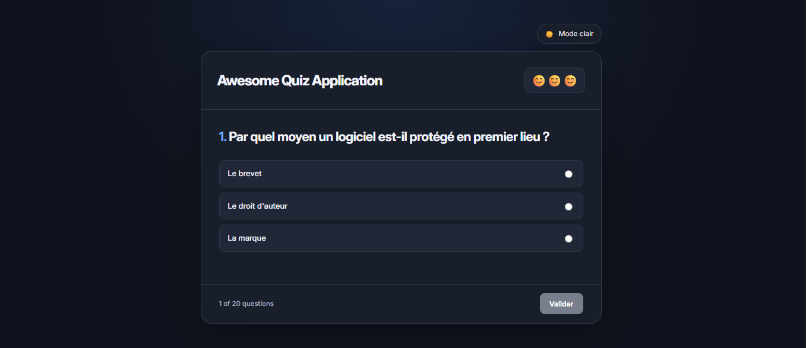

# 🧠 quiz-ma_v1

Une application de quiz interactive développée avec **React**, **TypeScript** et **Vite**.

## 📸 Aperçu



## 🚀 Fonctionnalités
- 📝 Questions à choix multiples.
- ⏱️ Calcul du score en temps réel.
- ⚡ Interface rapide et fluide grâce à Vite.

## 🛠️ Lancement en local

Pour tester le projet sur votre machine :

1. **Installer les dépendances :**
   ```bash
   npm install
   ```

2. **Lancer le serveur de développement :**
   ```bash
   npm run dev
   ```

## 🌐 Déploiement
L'application est hébergée sur **Vercel** a l'adresse : [text](https://quiz-ma-v1.vercel.app/).
